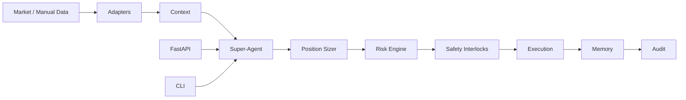
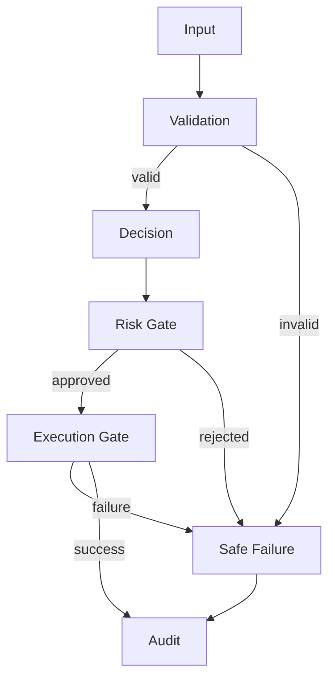

# TEXTRADER X — Architecture

## 1. Architectural Intent

TEXTRADER X is organized as a layered decision-engineering system.

## 2. Core Principles

1. Explicit component boundaries.
2. Separation of decision and execution.
3. Deterministic risk gates.
4. Safety-first failure boundaries.
5. Persistent state and auditability.
6. Reproducible validation.
7. Historical provenance.
8. Clear operator interfaces.

## 3. Failure Boundary

## 4. Control Plane

CLI and web interfaces are control/observability surfaces. Core business logic
should remain testable independently of the presentation layer.

## 5. Historical Boundary

Release-specific source and documentation are preserved under `releases/`.
Provenance is recorded under `provenance/`.
