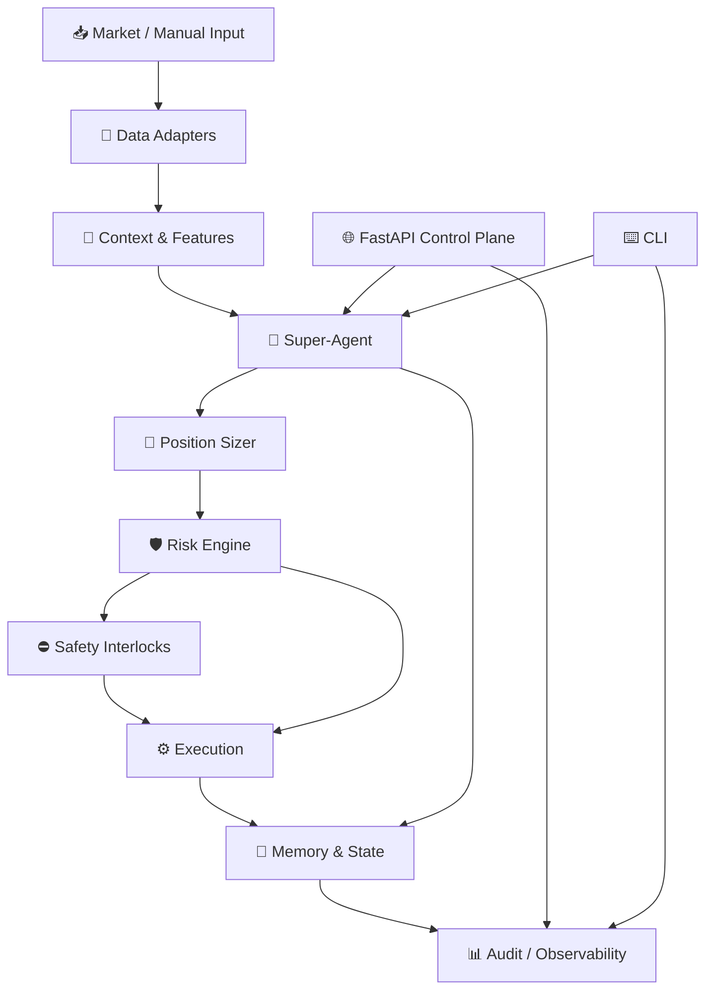
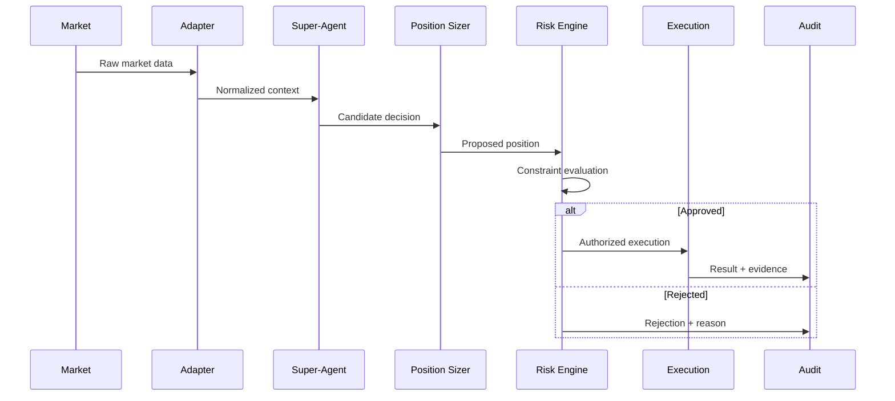
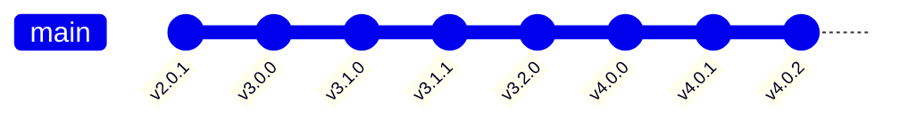

<div align="center">

# ⚡ TEXTRADER X

### Autonomous Trading Intelligence & Decision Engineering Platform

**Agentic orchestration · position sizing · deterministic risk controls · execution safety · memory · auditability**

<br>

[](releases/v4.0.2)
[](https://www.python.org/)
[](../../actions)
[](SECURITY.md)
[](ARCHITECTURE.md)

</div>

---

## 🧭 System Overview

TEXTRADER X is an engineering platform for automated trading decision systems.

Its architecture separates market data, context construction, decision orchestration,
position sizing, risk controls, execution, persistence, and observability.

> **Engineering boundary:** validation of software behavior does not constitute a
> guarantee of profitability or financial performance.



---

## 🧠 Decision Pipeline



---

## 🧬 Release Lineage



```text
v2.0.1
  │
  ▼
v3.0.0
  │
  ▼
v3.1.0
  │
  ▼
v3.1.1
  │
  ▼
v3.2.0
  │
  ▼
v4.0.0
  │
  ▼
v4.0.1
  │
  ▼
v4.0.2
```

---

## 🏗️ Repository Architecture

```text
TEXTRADER-X/
│
├── .github/                    # CI, release automation, templates
├── trader/                     # Production implementation
├── tests/                      # Automated tests
├── benchmarks/                 # Benchmarks / reproducibility
├── configs/                    # Runtime configuration
│
├── docs/
│   ├── architecture/
│   ├── engineering/
│   ├── specifications/
│   ├── research/
│   ├── security/
│   ├── testing/
│   └── source-of-truth/
│
├── releases/                   # Preserved release-specific material
├── evidence/                   # Validation evidence
├── research/                   # Research material
├── architecture/               # Architecture artifacts
├── provenance/                 # SHA-256 + lineage + inventories
│
├── README.md
├── ARCHITECTURE.md
├── CHANGELOG.md
├── SECURITY.md
├── CONTRIBUTING.md
└── pyproject.toml
```

### Engineering layers

| Layer | Responsibility |
|---|---|
| 🔌 Adapters | External/market data boundaries |
| 🧠 Context | Normalize decision context |
| 🤖 Agent | Decision orchestration |
| 📐 Position Sizer | Position/trade sizing |
| 🛡️ Risk Engine | Risk constraints |
| ⛔ Interlocks | Safety and kill-switch boundaries |
| ⚙️ Execution | Approved action execution |
| 💾 Memory | State and decision history |
| 📊 Observability | Audit and diagnostics |
| 🌐 Web | Administrative control plane |
| ⌨️ CLI | Operator/developer interface |

---

## 🧪 Verification Surface

Typical checks:

```bash
python -m compileall -q trader tests
pytest -q
pip check
```

Repository evidence is organized under:

```text
evidence/
provenance/
releases/
```

---

## 🔐 Security

Security engineering includes:

- secret exclusion
- execution boundaries
- safety interlocks
- kill-switch behavior
- regression validation
- release checksums
- provenance
- auditable decision evidence

See [`SECURITY.md`](SECURITY.md).

---

## 📦 Release History

| Release | Role |
|---|---|
| `v2.0.1` | Historical baseline |
| `v3.0.0` | Major 3.x generation |
| `v3.1.0` | 3.1.x generation |
| `v3.1.1` | Debugged 3.1.x release |
| `v3.2.0` | 3.2.x generation |
| `v4.0.0` | Major 4.x generation |
| `v4.0.1` | 4.x refinement |
| `v4.0.2` | Current canonical release |

Exact release material is preserved under `releases/`.

---

## 🚀 Quick Start

```bash
git clone https://github.com/YOUR_USERNAME/TEXTRADER-X.git
cd TEXTRADER-X

python3 -m venv .venv
source .venv/bin/activate

python -m pip install --upgrade pip
pip install -e ".[dev]"

python -m compileall -q trader tests
pytest -q
```

---

## 📚 Documentation Map

| Document | Purpose |
|---|---|
| [`ARCHITECTURE.md`](ARCHITECTURE.md) | System architecture |
| [`CHANGELOG.md`](CHANGELOG.md) | Release evolution |
| [`SECURITY.md`](SECURITY.md) | Security policy |
| [`CONTRIBUTING.md`](CONTRIBUTING.md) | Engineering workflow |
| `docs/engineering/` | Release engineering |
| `docs/testing/` | Validation |
| `provenance/` | File/source provenance |
| `releases/` | Historical release surfaces |

---

## 🧾 Provenance Philosophy

TEXTRADER X deliberately preserves historical project material.

The repository distinguishes between:

```text
SOURCE
  ↓
RELEASE
  ↓
EVIDENCE
  ↓
PROVENANCE
  ↓
CURRENT ENGINEERING SURFACE
```

Historical documents are not silently rewritten simply to make the repository
look cleaner. The engineering layer explains lineage while preserving source
material.

---

<div align="center">

### ⚡ TEXTRADER X

**Engineering · Risk · Agentic Systems · Reproducibility · Auditability**

</div>
